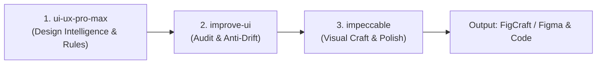
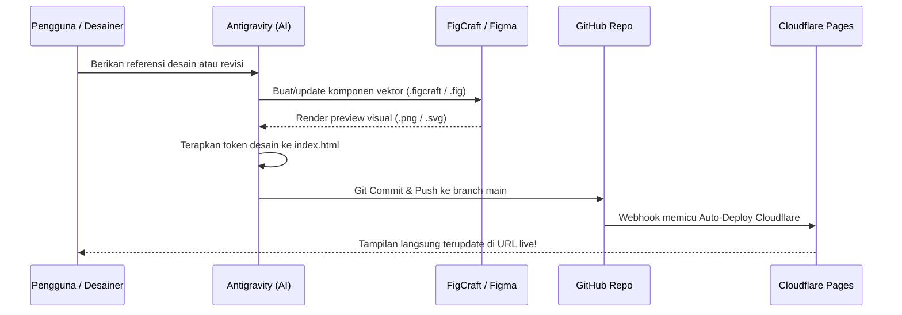

# 🎨 PANDUAN PENGGUNAAN FIGCRAFT & SKILLS UI/UX DI ANTIGRAVITY

Dokumen ini memuat panduan lengkap bagi desainer, developer, atau pengelola proyek selanjutnya dalam mengunduh **FigCraft**, memahami **Skill UI/UX** yang digunakan di Antigravity, serta cara menghubungkan keduanya untuk merancang antarmuka web secara profesional dan terotomatisasi.

---

## 1. Mengenal FigCraft & Mengapa Digunakan

**FigCraft** adalah perangkat lunak desain antarmuka (*interface design tool*) modern berbasis vektor yang dirancang untuk menjembatani dunia desain grafis dan otomasi kode/AI.

### Keunggulan Utama FigCraft:
1. **Dua Format Kompatibel Penuh**:
   - Format asli: `.figcraft`
   - Mendukung impor dan ekspor langsung ke format **Figma (`.fig`)**, **Penpot (`.penpot`)**, **SVG**, dan **JSON**.
2. **Headless CLI (`figcraft-cli`)**:
   - Memiliki mesin otomasi terminal untuk merender canvas ke gambar (`.png`, `.webp`, `.svg`) tanpa perlu membuka GUI aplikasi.
   - Dapat mengeksekusi instruksi desain berbasis script (JSON array of commands) untuk membuat ratusan elemen secara presisi hanya dalam hitungan detik.
3. **Dukungan MCP (Model Context Protocol)**:
   - Terhubung langsung dengan AI Agent seperti **Antigravity** via MCP, sehingga agen AI dapat membaca struktur layer, mengubah warna, membuat komponen, dan merender ulang desain secara *live*.

---

## 2. Cara Mengunduh & Memasang FigCraft

### A. Memasang `figcraft-cli` di Linux / Mac / WSL
Jika Anda menggunakan terminal Linux/macOS, executable `figcraft-cli` dapat ditempatkan di direktori binary pengguna (`~/.local/bin/` atau `/usr/local/bin/`):

```bash
# 1. Pastikan folder ~/.local/bin tersedia di PATH
export PATH="$HOME/.local/bin:$PATH"

# 2. Cek apakah figcraft-cli sudah terpasang
figcraft-cli --version
# Output: figcraft-cli 0.16.0
```

### B. Membuka File Desain di Figma (Tanpa Install Aplikasi Tambahan)
Jika Anda lebih terbiasa menggunakan **Figma Web / Desktop**:
1. Buka [Figma.com](https://figma.com) dan login ke akun Anda.
2. Di dashboard Figma, klik tombol **Import** di pojok kanan atas.
3. Pilih berkas **[`WIKA_CCMS_Monitoring.fig`](./WIKA_CCMS_Monitoring.fig)** dari repositori ini.
4. Kanvas desain 1920×1080 WIKA CCMS Monitoring akan langsung terbuka lengkap dengan seluruh vektor, teks, dan grup komponennya.

---

## 3. Penjelasan 3 Skill Desain Utama di Antigravity

Dalam pengembangan dashboard ini, Antigravity menggunakan 3 skill spesialisasi tinggi:



### 1. `ui-ux-pro-max` (Design Intelligence)
* **Fungsi**: Mesin basis data sistem desain terlengkap yang menyimpan aturan desain, palet warna industri, tipografi, dan standar aksesibilitas WCAG.
* **Perannya dalam Proyek**:
  - Menentukan palet warna korporat WIKA (Primary Blue `#003B70`, Navy `#0A4285`, Cyan `#38BDF8`).
  - Menentukan tipografi *Plus Jakarta Sans* dengan skala hierarki yang harmonis.
  - Memberikan aturan visualisasi data untuk Donut Chart, Grouped Bar Chart, dan Matrix status dokumen.

### 2. `improve-ui` (Audit & Kontrol Kualitas UI)
* **Fungsi**: Mengaudit antarmuka berdasarkan bukti desain nyata (*design evidence*), memeriksa apakah ada kontradiksi visual, inkonsistensi spacing, atau elemen yang keluar dari sistem.
* **Perannya dalam Proyek**:
  - Mengeliminasi latar belakang putih yang sebelumnya mengotori logo WIKA.
  - Memastikan kontras rasio warna status (Hijau Lengkap `#10b981`, Oranye Belum Lengkap `#f59e0b`, Merah Belum Diisi `#ef4444`, Abu Nihil `#94a3b8`).
  - Merapikan spacing card agar proporsional dan tidak meninggalkan rongga kosong (*gap*).

### 3. `impeccable` (Visual Craft & Production Polish)
* **Fungsi**: Mengangkat kualitas visual ke tingkat *production-grade* kelas dunia (micro-interaction, shadow elevation, border radius, dark/light mode continuity).
* **Perannya dalam Proyek**:
  - Membangun ilustrasi arsitektur vektor gedung bertingkat dan *lattice tower crane* di sidebar dan kartu statistik.
  - Mengatur efek *glassmorphism* lembut, transisi hover, dan *freezing* sidebar saat halaman di-scroll.

---

## 4. Cara Menghubungkan Antigravity dengan FigCraft

Ada dua cara menghubungkan Antigravity dengan FigCraft untuk mendesain:

### Metode 1: Otomasi Scripting & CLI (Headless Workflow)
Antigravity dapat membuat atau mengedit desain secara terprogram tanpa membuka jendela aplikasi:

1. **Membuat File Desain dari Skrip Python / JSON**:
   Antigravity menulis perintah bentuk vektor, teks, warna, dan posisi ke file generator (contoh: `generate_wika_figcraft.py`), lalu mengeksekusinya via:
   ```bash
   figcraft-cli run commands.json
   ```
2. **Merender Desain Menjadi Gambar Preview**:
   ```bash
   figcraft-cli render WIKA_CCMS_Monitoring.figcraft -o assets/WIKA_CCMS_Monitoring_render.png
   ```
3. **Mengonversi Antara FigCraft dan Figma**:
   ```bash
   # Ekspor ke file Figma asli
   figcraft-cli convert WIKA_CCMS_Monitoring.figcraft WIKA_CCMS_Monitoring.fig

   # Impor dari file Figma ke FigCraft
   figcraft-cli convert WIKA_CCMS_Monitoring.fig WIKA_CCMS_Monitoring.figcraft
   ```

---

### Metode 2: Integrasi Real-Time via MCP (Model Context Protocol)
MCP memungkinkan Antigravity berinteraksi langsung dengan kanvas FigCraft yang sedang berjalan:

1. **Jalankan Aplikasi FigCraft dengan Port Kontrol**:
   ```bash
   figcraft --control 4000
   ```
2. **Hubungkan Antigravity / AI Client ke Server MCP**:
   Jalankan server MCP FigCraft yang terhubung ke port aplikasi tersebut:
   ```bash
   figcraft-cli mcp --attach 4000
   ```
3. **Atau Jalankan Server MCP Secara Headless**:
   ```bash
   figcraft-cli mcp --automation-write-root .
   ```
4. **Instruksikan Antigravity di Chat**:
   Anda cukup memberikan perintah dalam bahasa manusia, contoh:
   > *"Antigravity, tolong buatkan komponen Card baru berukuran 400x200 dengan warna background #ffffff, border radius 12px, dan tambahkan chart donut di dalamnya pada kanvas FigCraft."*
   Antigravity akan mengeksekusi tool MCP untuk menggambar komponen tersebut langsung pada kanvas.

---

## 5. Alur Kerja Siklus Penuh: Dari Desain Hingga Live Web



1. **Desain**: Dibuat atau diperbarui di **FigCraft** / **Figma**.
2. **Koding**: Antigravity menerapkan struktur CSS, token warna, dan SVG yang sama ke **`index.html`**.
3. **Deploy**: Push ke GitHub langsung memicu pembaruan otomatis di **Cloudflare Pages (`https://monitoring-ccms-dashboard.pages.dev/`)**.

---
*Dokumen ini disusun untuk memudahkan serah terima teknis dan kolaborasi desain berkelanjutan.*
